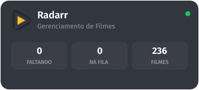
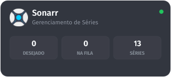
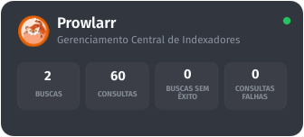
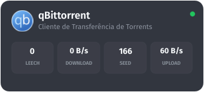
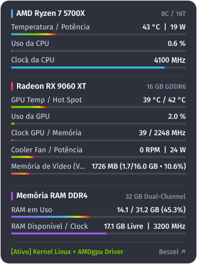

# Media Server & Hardware Widgets para KDE Plasma 6

Uma coleção coesa de widgets nativos (Plasmoids) com visual **Glassmorphism** para o **KDE Plasma 6**, desenvolvida para monitorar serviços de mídia (*Homelab / Arr stack*) e sensores de hardware em tempo real com **consumo praticamente zero de recursos do sistema**.

---

## 📸 Screenshots

| Jellyfin | Radarr | Sonarr |
| :---: | :---: | :---: |
|  |  |  |

| Prowlarr | qBittorrent | Monitor de Hardware |
| :---: | :---: | :---: |
|  |  |  |

---

## 🧩 Widgets Inclusos

1. **Jellyfin** (`io.mediaserver.jellyfin`)
   * Exibe a contagem de **Filmes**, **Séries** e **Episódios** da biblioteca.
   * Mostra em tempo real o status **Now Playing** (*TOCANDO / PAUSADO*, nome da série/filme, temporada/episódio, usuário e barra de progresso).
   * Ao clicar no card, abre diretamente o seu cliente desktop instalado (ex: **Jellium Desktop**, **Jellyfin Media Player**, **Delfin**) ou a interface Web no navegador.
2. **Radarr** (`io.mediaserver.radarr`)
   * Monitora filmes **Faltando**, **Na Fila** de download e o total de **Filmes** (integrado ao Jellyfin ou contado diretamente pelo próprio Radarr).
3. **Sonarr** (`io.mediaserver.sonarr`)
   * Monitora episódios **Desejados**, **Na Fila** de download e o total de **Séries** (integrado ao Jellyfin ou contado diretamente pelo próprio Sonarr).
4. **Prowlarr** (`io.mediaserver.prowlarr`)
   * Exibe as métricas consolidadas dos indexadores: **Buscas (Grabs)**, **Consultas (Queries)**, **Buscas sem Êxito** e **Consultas Falhas**.
5. **qBittorrent** (`io.mediaserver.qbittorrent`)
   * Exibe a quantidade de torrents em **Leech** e **Seed**, além das velocidades globais de **Download** e **Upload** em tempo real.
6. **Monitor de Hardware** (`io.system.hwmonitor`)
   * **Auto-detecção completa de hardware:** detecta automaticamente o modelo da CPU (AMD/Intel), contagem de núcleos e threads, placa de vídeo (AMD `amdgpu` ou NVIDIA `nvidia-smi`), quantidade de VRAM e especificações da Memória RAM.
   * Lê sensores de temperatura, Hot Spot, potência (Watts), clocks, rotação de fans (RPM) e uso de memória diretamente do kernel Linux (`/sys/class/hwmon` e `/proc`), sem precisar de programas pesados rodando em segundo plano.

---

## ⚙️ Como Funciona

* **Zero Processos Extras:** Todos os cards são construídos nativamente em **QML (Qt6)** para o KDE Plasma 6 e rodam dentro do próprio `plasmashell`, sem consumir memória com navegadores embutidos ou daemons externos.
* **Configuração 100% pela Interface Gráfica (UI):** Não é necessário editar arquivos de código para colocar suas senhas ou chaves de API. Basta clicar com o **botão direito** sobre qualquer widget na área de trabalho e selecionar **"Configurar..."**.
* **Escala Proporcional:** Os cards possuem tamanho base alinhado (`320px` de largura), mas podem ser redimensionados livremente no Modo de Edição do KDE sem distorcer o layout.

---

## 🚀 Como Instalar

### Opção 1: Direto pelo KDE Plasma via Releases (Recomendado — Mais Fácil)
Você não precisa usar o terminal nem instalar fontes manualmente (a fonte **Fira Sans** já vai embutida dentro de cada arquivo `.plasmoid`):

1. Acesse a aba [**Releases**](../../releases) deste repositório e baixe apenas os arquivos **`.plasmoid`** dos widgets que desejar usar:
   * `io.mediaserver.jellyfin.plasmoid`
   * `io.mediaserver.radarr.plasmoid`
   * `io.mediaserver.sonarr.plasmoid`
   * `io.mediaserver.prowlarr.plasmoid`
   * `io.mediaserver.qbittorrent.plasmoid`
   * `io.system.hwmonitor.plasmoid`
2. Clique com o **botão direito** na Área de Trabalho do KDE Plasma e selecione **"Adicionar ou gerenciar widgets..."**.
3. No canto superior direito do painel de widgets, clique em **"Obter novos..."** → **"Instalar widget a partir de arquivo local..."**.
4. Selecione o(s) arquivo(s) `.plasmoid` baixado(s) e pronto!

---

### Opção 2: Instalador Gráfico em Lote (`install.sh`)
Caso tenha baixado o pacote completo (`kde-media-hardware-widgets-bundle.zip`) ou clonado o repositório e queira marcar quais widgets instalar ou remover por uma janela interativa:

```bash
chmod +x install.sh uninstall.sh reload.sh
./install.sh
```

Uma janela nativa do KDE (`kdialog`) será aberta permitindo:
* **Escolher exatamente quais widgets** você deseja instalar ou desinstalar (marcando ou desmarcando na lista).
* Instalar ou limpar tudo sem deixar arquivos órfãos.

---

### Opção 3: Atalhos Rápidos via Terminal (CLI)

| Comando | O que faz |
| :--- | :--- |
| `./install.sh` | Abre o gerenciador interativo (Janela Gráfica no KDE ou menu no terminal) |
| `./install.sh --install-all` | Instala todos os 6 widgets de uma vez (copiando os arquivos para o sistema) |
| `./install.sh --dev` | Instala todos os 6 widgets usando **Links Simbólicos** (ideal para quem quer editar o código-fonte nesta pasta) |
| `./install.sh --cli` | Força o menu interativo em modo texto no terminal |
| `./reload.sh` | Limpa o cache de sensores (`/dev/shm`), limpa o cache QML do KDE e reinicia o `plasmashell` para aplicar alterações na hora |
| `./build-release.sh` | Gera os pacotes `.plasmoid` individuais (sem chaves/senhas pessoais) na pasta `release/` |

---

## 🖥️ Como Adicionar e Configurar na Área de Trabalho

1. Clique com o **botão direito** na Área de Trabalho do KDE Plasma e selecione **"Adicionar ou gerenciar widgets..."** (ou **"Entrar no Modo de Edição"**).
2. Pesquise pelo nome do widget desejado: **Jellyfin**, **Radarr**, **Sonarr**, **Prowlarr**, **qBittorrent** ou **Monitor de Hardware**.
3. Arraste os widgets para a área de trabalho.
4. Clique com o **botão direito** sobre cada widget adicionado e escolha **"Configurar..."** para inserir a URL do seu servidor e sua **API Key / Senha**.

---

## 🗑️ Como Desinstalar (Sem Arquivos Remanescentes)

### Pelo próprio KDE Plasma (se instalou via arquivo `.plasmoid`):
1. Clique com o **botão direito** no widget na Área de Trabalho e selecione **"Remover..."**.
2. Abra **"Adicionar ou gerenciar widgets..."**, passe o mouse sobre o widget na lista e clique no ícone de lixeira (**Desinstalar widget**).

### Pelo Desinstalador Automático (`uninstall.sh` / `install.sh`):
O script desinstalador faz uma **limpeza completa**: remove automaticamente os widgets ativos da sua Área de Trabalho (evitando caixas de erro no KDE), apaga os pacotes em `~/.local/share/plasma/plasmoids/`, remove os arquivos temporários em `/dev/shm`, limpa o cache QML e remove as fontes extras caso nenhum widget do pacote permaneça no sistema.

* **Para desinstalar tudo imediatamente em 1 comando:**
  ```bash
  ./uninstall.sh
  ```
  *(ou `./install.sh --uninstall-all`)*

* **Para escolher apenas alguns widgets para desinstalar:**
  Execute `./install.sh` e selecione a opção **"Desinstalar Widgets específicos"** na janela gráfica.
